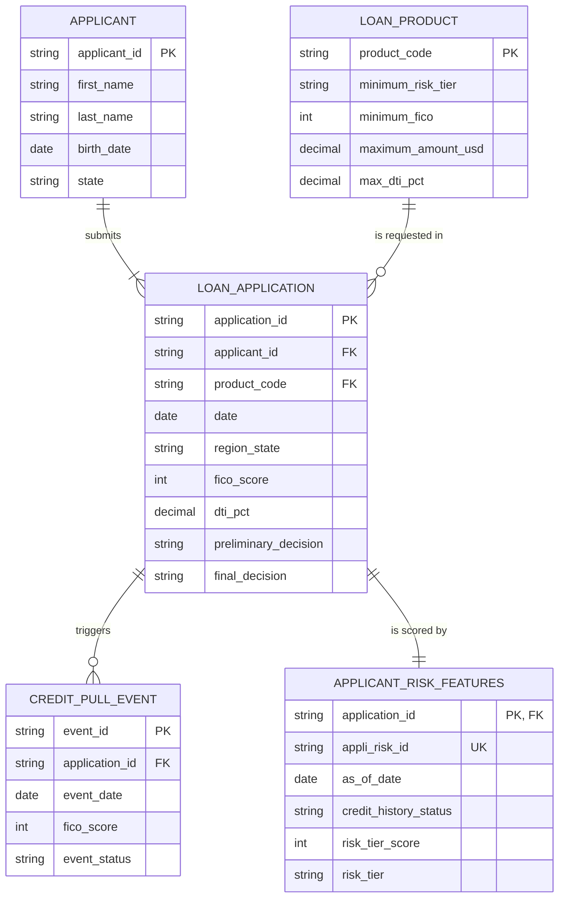

# Entity Relationship Diagram (ERD)

The image above predates the applicant table. The diagram below is the current model.

## Summary
The structured-data layer contains five datasets: Applicants, Loan Applications, Applicant Risk Features, Credit Pull Events, and Loan Products.

**0. Applicant to Application**

An applicant (person) can submit one or many applications, and each application has exactly one applicant. There are no co-applicants. If an applicant moves or changes details, they submit a new application, so each application keeps the state it was submitted from.
-  Relationship: 1 to 1..N (One-to-Many)
-  Key Link: applicant_id becomes a Foreign Key inside the Application table.

 
**1. Loan Product to Application**

A loan product can be selected by zero, one, or many applications. However, an individual application is typically submitted for exactly one specific loan product.
-  Relationship: 1 to 0..N (One-to-Many)
-  Key Link: product_code becomes a Foreign Key inside the Application table.

**2.  Application to Credit Pull Event**
 
 An application is submitted first, which triggers zero, one, or multiple Credit Pull Events (e.g., pulling from Equifax, Experian, or re-pulling due to delays). Each credit pull event is tied explicitly to that single application instance.
-  Relationship: 1 to 0..N (One-to-Many, Optional)
-  Key Link: application_id becomes a Foreign Key inside the Credit Pull Event table.

**3.  Application to Applicant Risk Features**

A loan application is submitted first, which generates exactly one associated applicant risk feature record to hold the evaluation metrics for that specific request. This single risk feature record is tied explicitly to that single application instance to preserve a point-in-time underwriting audit trail.
-  Relationship: 1 to 1 (One-to-One, Mandatory)
-  Key Link: application_id is both the primary key and a Foreign Key of the Applicant_Risk_Feature table (one row per application), and appli_risk_id is a unique surrogate identifier, as declared in applicant_risk_features.yaml.

Analytically, these datasets can be combined to evaluate applicant eligibility, examine credit-risk changes over time, compare applicant characteristics with product requirements, and create features for downstream analytical or machine-learning applications.
